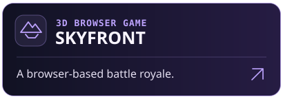
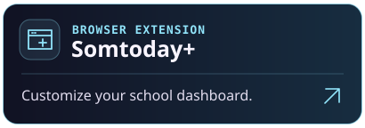
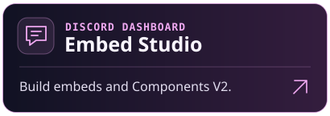
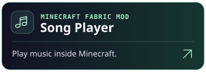

  

  <h1>Hey, I'm Cozynxis</h1>
  
<strong>Full-stack developer</strong> building web apps, Discord bots, browser extensions and games.

  
Open to freelance work and collaborations.

  

    <a href="https://github.com/Cozynxis?tab=repositories"><strong>Browse repositories</strong></a>
    · <a href="https://github.com/Cozynxis?tab=overview#contribution-activity">See GitHub activity</a>
  

## Featured projects

  
  
  
  

## Tech stack

| Area | What I use |
| :-- | :-- |
| Languages & markup | `JavaScript` · `Python` · `HTML` · `CSS` |
| Frameworks & runtime | `React` · `Node.js` · `Express` |
| Database | `MongoDB` |
| Development tools | `Git` · `GitHub` · `Docker` · `VS Code` |

## GitHub activity

  

